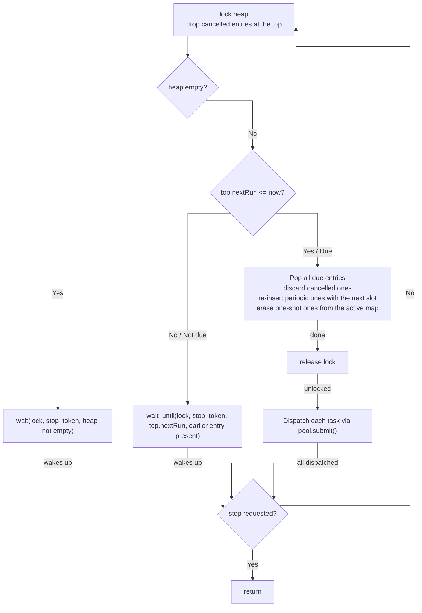

# ADR-0004: Scheduler as a Separate Class

**Status:** Accepted
**Date:** 2026-10

## Context

Metric collectors must be invoked periodically (e.g., CPU every 500 ms, RAM every 1 s). Two options exist:

**Option A - Scheduling built into ThreadPool**
Add `submitPeriodic(interval, callback)` directly to `ThreadPool`.

**Option B - Separate `Scheduler` class**
`Scheduler` owns a timing structure and a dedicated thread. It dispatches due tasks to an injected `ThreadPool`.

## Decision

**Option B - Separate `Scheduler` class** with `ThreadPool` injected by reference.

## Rationale

**Single Responsibility:** `ThreadPool` manages worker threads and executes callables. Timing logic is a distinct concern. Mixing them would make `ThreadPool` harder to test and benchmark in isolation.

**Testability:** `Scheduler` can be tested against a real `ThreadPool` independently. `ThreadPool` benchmarks remain unaffected by scheduling complexity.

**Flexibility:** Callers may use `ThreadPool` without scheduling, or compose a different timing strategy on top of the same pool.

## Design

### Data structures

Two separate data structures serve two separate purposes:

- **`ThreadPool`** holds a FIFO `std::queue<Task>` - tasks waiting for a free worker thread. No timing involved.
- **`Scheduler`** holds a min-heap (`std::priority_queue` with a comparator) of entries keyed on `nextRun` (`std::chrono::steady_clock::time_point`). The heap is ordered by execution time, not by importance - the earliest due task is always at the top. Tasks with the same `nextRun` are dispatched in the order of their `TaskId`, i.e. in the order they were scheduled, so the dispatch order is deterministic.

Each scheduled task has one shared state (`TaskState`, held by `std::shared_ptr`) with the callback, the interval (zero for one-shot tasks), the cancellation state and whether a run is in progress. The heap entries and the callables submitted to the pool point to this same state. In this document these submitted callables are called wrappers. Besides the heap, `Scheduler` keeps a map of all active tasks, indexed by `TaskId`, which is used by `cancel()`, and its entries point to the same state as well.

When a task becomes due, the scheduler does not submit the user's task directly. It calls `pool.submit(wrapper)`, where the wrapper is a small callable that checks cancellation and whether the previous run is still active, catches exceptions and then calls the user's task. Submitting the wrapper moves the task from the timing heap into the ThreadPool queue for execution. The wrapper captures only the shared `TaskState`, never the `Scheduler` itself.

```
Scheduler min-heap → (when due) → pool.submit() → ThreadPool FIFO → worker
```

### Public API

- `Scheduler` is neither copyable nor movable.
- `Task` is `ThreadPool::Task`, `Clock` is `std::chrono::steady_clock`, and `using TaskId = std::uint64_t` - ids are unique and never reused.
- `TaskId scheduleOnce(Clock::duration delay, Task task)` - runs once after `delay`. A zero or negative delay means "due immediately". An empty task throws `std::invalid_argument`.
- `TaskId schedulePeriodic(Clock::duration interval, Task task)` - the first run happens one `interval` after the call. Callers who want an immediate first run also call `scheduleOnce` with a zero delay. A zero or negative interval and an empty task throw `std::invalid_argument`.
- `bool cancel(TaskId id)` - returns `true` if the task was still active, i.e. a one-shot task that was not dispatched yet or a periodic task that was not cancelled yet (a periodic task stays active after each dispatch). Returns `false` for unknown ids, for already cancelled tasks and for one-shot tasks that were already dispatched.

### Scheduler loop

The scheduler thread is a `std::jthread` that waits on a `std::condition_variable_any` using the `std::stop_token` overloads of `wait` and `wait_until` (see ADR-0003).



`steady_clock` is used over `system_clock` to avoid timer jumps from NTP adjustments or manual clock changes. The mutex is released before calling `m_pool.submit()`. Otherwise `scheduleOnce()`, `schedulePeriodic()` and `cancel()` from other threads would block on the scheduler mutex while the scheduler thread waits for the pool queue lock, and the two mutexes would be nested. Callbacks run on pool threads and never while the scheduler mutex is held, so a callback may call `scheduleOnce()`, `schedulePeriodic()` and `cancel()`, for example to cancel itself.

### Periodic tasks: drift and catch-up

The next run time is computed from the planned start, not from the actual dispatch time and not from the end of the run: `nextRun += interval`. Dispatch latency therefore does not accumulate as drift. If the new `nextRun` is already in the past (the scheduler thread was delayed or the machine was suspended), the missed slots are not run later. Instead `nextRun` jumps to the first slot after `now`, so the task runs once and then continues in its normal rhythm. A burst of catch-up runs never happens.

### Slow tasks: skip instead of overlap

If the previous run of a task has not finished when its next tick is due, the tick is skipped. The same callback therefore never runs concurrently with itself, and a slow task cannot flood the pool with its own copies. The skipped tick is not caught up later.

### Cancellation

- `cancel(id)` removes the id from the active map and requests stop on the `std::stop_source` of the shared state. It never waits for anything.
- The wrapper checks `stop_requested()` directly before calling the callback, so a run of a periodic task that was already submitted to the pool but has not started yet is not executed either.
- Once a one-shot task has been dispatched, it is no longer active. `cancel()` then returns `false`, and the run that is already waiting in the pool queue still happens.
- A callback that is already running when `cancel()` is called is not interrupted, there is no way to do so. `cancel()` returns before the callback finishes. A caller who needs to know that the callback is done must provide that synchronisation itself, for example with a latch or by owning the captured state through a `shared_ptr`.
- Cancelling a periodic task from inside its own callback is allowed.
- Per-task cancellation uses a `std::stop_source` and not an `atomic<bool>`, because `std::stop_token` is the standard mechanism for cooperative cancellation in C++20. It also leaves room for a later extension that hands the token to the task. The cost is one small allocation per scheduled task, which is negligible at the low scheduling rate (see ADR-0002). This stop source is unrelated to the stop token of the scheduler thread, which only signals the destruction of the whole scheduler.
- The heap entry of a cancelled task stays until it reaches the top, where it is dropped without waking the scheduler for it.

### Exceptions

The pool wrapper catches all exceptions from the callback and discards them. A periodic task keeps running after an exception. If `pool.submit()` itself throws (e.g. `std::bad_alloc`), the scheduler thread catches it and drops that tick, since an exception escaping the thread function would call `std::terminate`. `libs/concurrent` has no logging dependency, so there is no reporting hook. An optional error handler is a possible later extension.

### Shutdown and lifetime

- `Scheduler` holds a non-owning reference to `ThreadPool`. `ThreadPool` must outlive `Scheduler`, otherwise the behaviour is undefined. In `MonitorCore` this is enforced by declaration order.
- The destructor requests stop and joins the scheduler thread before any other member is destroyed. Entries that are still in the heap are discarded and never run.
- Stop is checked before every `pool.submit()`, so the scheduler never submits once its destruction has begun. This also keeps the rule of `ThreadPool::submit()` ("must not be called once destruction has begun") intact.
- Tasks that were already submitted keep running after `~Scheduler`. This is safe because the wrapper holds only the shared `TaskState`. The `ThreadPool` drains its queue on destruction (see below), so those tasks complete before the pool is gone.

## ThreadPool shutdown semantics

The `ThreadPool` executes all queued tasks on destruction instead of discarding them. A future returned by `submit()` is therefore always fulfilled and never fails with `broken_promise`. The consequence is that destruction waits for the longest queued task. This is acceptable because collector tasks are short (see ADR-0002). The `std::stop_token` only wakes the idle workers, it is the shutdown signal and not a cancellation mechanism for tasks.

## Consequences

- Dispatch latency depends on the load of the shared pool. The timing is "at the earliest at the planned time", with jitter if all workers are busy.
- Slow periodic tasks lose ticks instead of overlapping. Callers do not need to make callbacks reentrant.
- Individual tasks cannot be interrupted once running. Cooperative cancellation would need a task signature with a `std::stop_token` parameter, which is a possible later extension together with a discarding shutdown mode for the pool.
- The clock is not injectable. Tests use real short intervals with latches and futures instead of sleeps.
