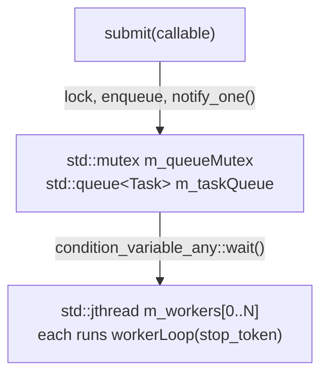
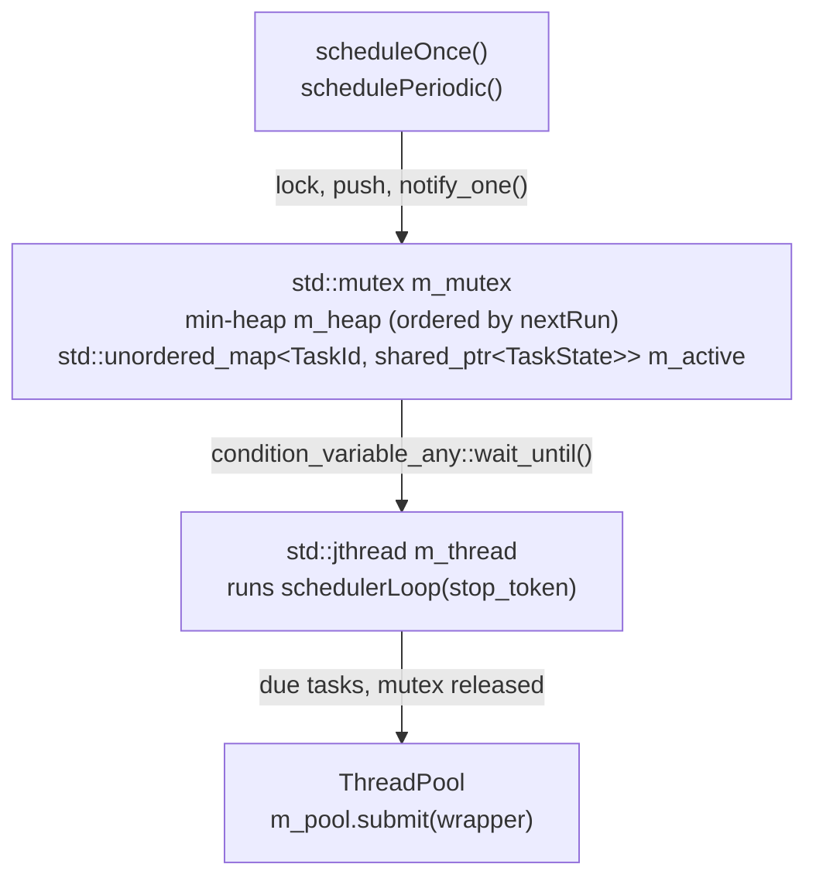

# libs/concurrent - Architecture and Internals

## Overview

`libs/concurrent` provides two components with clearly separated responsibilities:

| Component | Responsibility |
|---|---|
| `ThreadPool` | Manages worker threads and executes submitted callables |
| `Scheduler` | Tracks timing and dispatches due tasks to a `ThreadPool` |

The two components are intentionally decoupled: `ThreadPool` knows nothing about time, and `Scheduler` knows nothing about thread management.

## ThreadPool

### Internal Structure

Each worker blocks on `condition_variable_any::wait()` using the `std::stop_token` overload. A worker wakes on exactly two conditions: a new task in the queue, or a stop request. No other synchronisation primitives are needed.

### Shutdown Sequence

1. `ThreadPool` destructor is called.
2. `std::jthread` destructors fire in reverse declaration order - `m_workers` is declared last, so it destructs first.
3. Each `jthread` calls `request_stop()` then `join()` on its thread.
4. Each worker wakes from `wait()`, sees `stop_requested() == true` and an empty queue, and returns.
5. `m_queueMutex` and `m_taskQueue` are then safely destroyed.

Tasks that are still queued are executed before the workers exit, they are not discarded. Futures returned by `submit()` are therefore always fulfilled. The stop token only wakes idle workers, it does not cancel tasks. Destruction waits for the longest queued task, which is acceptable because collector tasks are short (see ADR-0002).

**Declaration order matters.** `m_workers` must be declared after `m_queueMutex` and `m_taskQueue` in the class so that it destructs first.

### submit() and std::packaged_task

`submit()` wraps the callable in a `std::packaged_task` held by a `std::shared_ptr`. The lambda stored in the queue calls the packaged task; the caller receives the associated `std::future<T>`. Exceptions thrown inside the callable are captured by the packaged task and rethrown on `future.get()`.

The `shared_ptr` is necessary because `std::packaged_task` is not copyable, but the `std::function<void()>` stored in the queue must be. The `shared_ptr` makes the non-copyable task indirectly copyable.

## Scheduler

### Internal Structure

The min-heap is ordered by `nextRun` (`steady_clock::time_point`) - the soonest task is always at the top. Tasks with the same `nextRun` are dispatched in the order of their `TaskId`, i.e. in the order they were scheduled. This is purely a timing mechanism, not a priority system. All tasks are equal in importance.

Every scheduled task has a shared `TaskState` with the callback, the interval, a `std::stop_source` for cancellation and an atomic `running` flag. Heap entries and the callables submitted to the pool share it through `std::shared_ptr`. In this document these submitted callables are called wrappers.

### Two Queues, Two Purposes

| Structure | Lives in | Ordered by | Purpose |
|---|---|---|---|
| `std::queue<Task> m_taskQueue` | `ThreadPool` | Insertion order (FIFO) | Which worker executes next |
| min-heap `m_heap` | `Scheduler` | Execution time (`nextRun`) | When to submit to the pool |

When a task becomes due, the scheduler removes it from the heap and calls `m_pool.submit()`, transferring it into the ThreadPool's FIFO queue.

### Waiting with stop_token

The scheduler thread uses the `std::stop_token` overloads of `condition_variable_any`: `wait()` while the heap is empty, like the workers of the `ThreadPool`, and `wait_until()` while it waits for the next deadline. A new task with an earlier `nextRun` wakes the thread so that it recomputes the deadline. After every wake-up the loop checks the stop token and the clock itself and does not rely on the return value of the wait.

### Mutex Release Before submit()

The scheduler releases `m_mutex` before calling `m_pool.submit()`. Otherwise `scheduleOnce()`, `schedulePeriodic()` and `cancel()` from other threads would block on `m_mutex` while the scheduler thread waits for the pool queue lock, and the two mutexes (scheduler `m_mutex` and ThreadPool `m_queueMutex`) would be nested. Callbacks run on pool threads and never while `m_mutex` is held, so a callback may call `scheduleOnce()`, `schedulePeriodic()` and `cancel()`, for example to cancel itself.

### Periodic Tasks

The next run is computed as `nextRun += interval`, i.e. from the planned start, so dispatch latency does not accumulate as drift. If the new `nextRun` is already in the past (for example because the scheduler thread was delayed or the machine was suspended), the missed slots are not run later. Instead `nextRun` jumps to the first slot after the current time, so the task runs once and then continues in its normal rhythm without a burst of catch-up runs. The `running` flag makes the pool wrapper skip a tick while the previous run of the same task is still active, so a callback never overlaps with itself.

### Cancellation

`cancel(id)` removes the id from `m_active` and requests stop on its `std::stop_source`, under the mutex and without waiting. It returns `true` if the task was still active, i.e. a one-shot task that was not dispatched yet or a periodic task that was not cancelled yet. The wrapper checks `stop_requested()` right before calling the callback, so a run of a periodic task that is already in the pool queue is not executed either. Once a one-shot task has been dispatched, it is removed from `m_active` and no longer active. `cancel()` then returns `false`, and the run that is already waiting in the pool queue still happens. A callback that is already running is not interrupted. The heap entry of a cancelled task stays until it reaches the top and is dropped there.

### Exceptions

The wrapper catches and discards all exceptions of the callback, a periodic task keeps running. An exception from `pool.submit()` is caught in the scheduler thread and the tick is dropped.

### Lifetime Rule

`Scheduler` holds a non-owning reference (`ThreadPool&`) to the pool. The `ThreadPool` must outlive the `Scheduler`. In `MonitorCore`, the `ThreadPool` is declared before the `Scheduler` - member destructors run in reverse declaration order, so the `Scheduler` is always destroyed first.

The destructor stops and joins the scheduler thread, entries still in the heap are discarded. Tasks already submitted to the pool are not affected, because the wrapper holds only the shared `TaskState` and not the `Scheduler`.

## Thread Safety Summary

| Method | Thread-safe |
|---|---|
| `ThreadPool::submit()` | ✓ |
| `ThreadPool::pendingTasks()` | ✓ (approximate) |
| `Scheduler::scheduleOnce()` | ✓ |
| `Scheduler::schedulePeriodic()` | ✓ |
| `Scheduler::cancel()` | ✓ |
